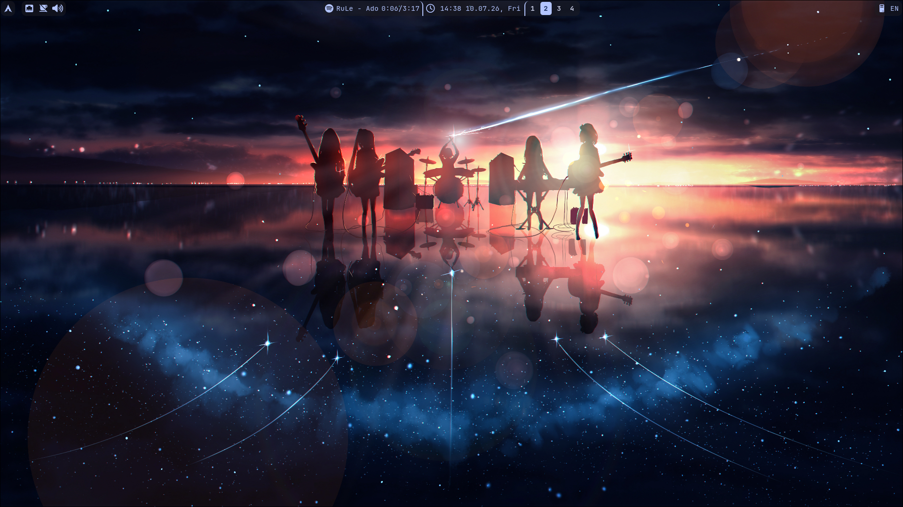
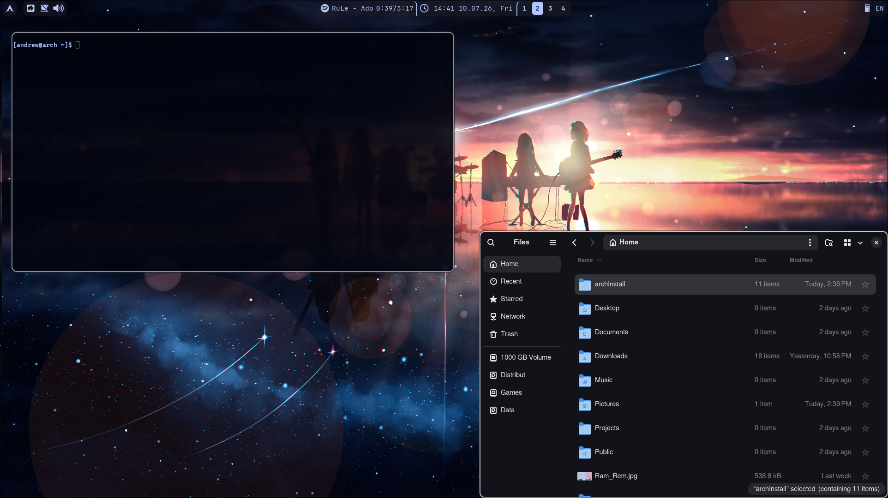

# HyprArchDots

Personal Arch Linux bootstrap script and configuration files for my Hyprland setup.

## Preview

## WARNING!
* **The installation script (`install.sh`) is intended for a fresh Arch Linux with Hyprland.**
* **It installs all packages I need for my personal setup.**
* **The script also installs Japanese fonts and fcitx5 for Japanese input.**
## Requirements:
- Arch Linux
- Hyprland
- Kitty
- GRUB (if you want to enable dual boot and install themes automatically)
- SDDM (if you want to install themes automatically)
## Installation
If you have a fresh Arch Linux that meets the requirements listed above, simply run `install.sh`.
Otherwise, install the configuration manually, as it has not been tested on an existing installation.

If you chose to back up your config files, they are located in `~/old_configs/`.
## What's installed:
#### Without confirmation:
- git
- yay
- Hypr ecosystem (Hyprpaper, Hyprpolkitagent, Hyprshot, Hypridle, Hyprpicker, Hyprlock, Hyprshutdown)
- swaync
- rofi
- wl-clipboard
- cava
- nm-applet
- matugen
- pipewire
- nautilus
- zscroll
- waybar-git
- python-setuptools
- fcitx5
- pavucontrol
- Some fonts
- Spotify
- MPV
#### With confirmation:
- Firewall (UFW)
- OBS
- VLC
- OpenTabletDrivers
- Krita
- Blender
- os-prober (if you have GRUB and choose to enable dual boot)
## Repository structure
- `install.sh`
- `.config/` folder
- `.local/` folder (now used only for fcitx5)
- `grub/` (contains themes for GRUB)
## Credits
I used files from the following projects:
#### GRUB themes (included in this repository):
- Poly-dark by [shvchk](https://github.com/shvchk/poly-dark/)(MIT)
- Blackice by [TomorrowX6](https://github.com/TomorrowX6/arch-grub)
- Astronaut by [Flava-Clown](https://github.com/Flava-Clown/AstronautGrub)
#### SDDM themes (cloned during installation):
- By [Keyitdev](https://github.com/Keyitdev/sddm-astronaut-theme) 
- License: GPL-3.0
#### Wallpapers are from [wallhaven](https://wallhaven.cc/) 

## License

This project is licensed under the MIT License.

This repository contains my own scripts and configuration files. 
Third-party projects remain the property of their respective authors. See the Credits section for details.